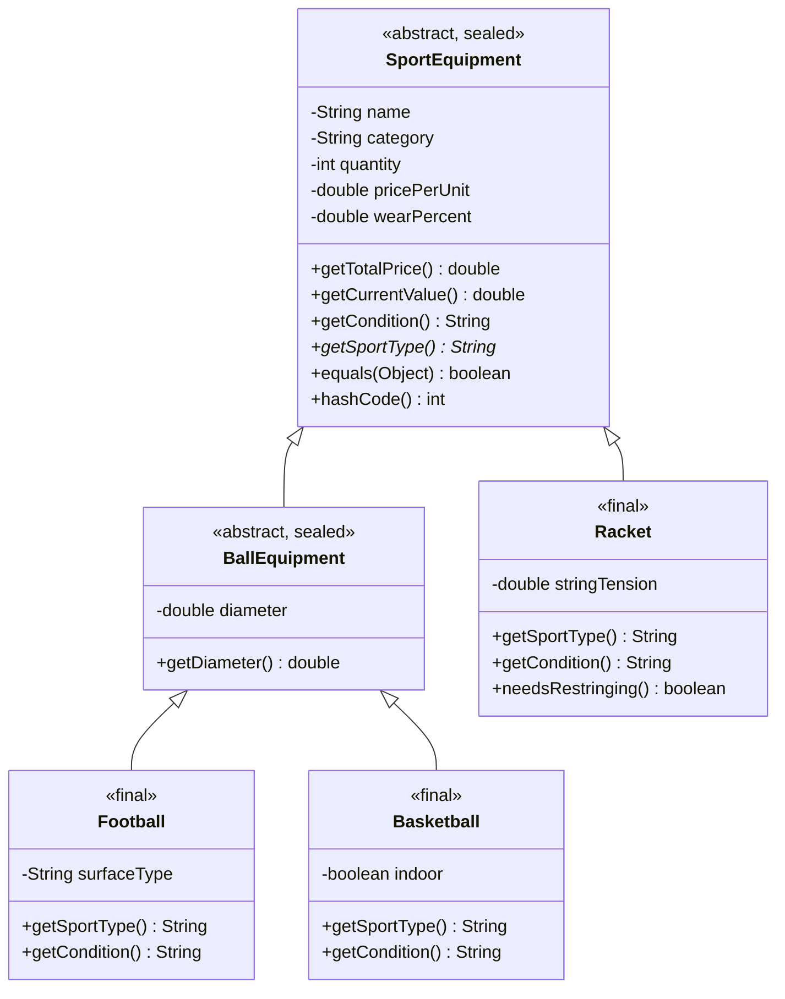

# Лабораторна робота №6 — Наслідування та поліморфізм у Java

## Тема

Реалізація ієрархії класів на основі принципів наслідування.

## Мета роботи

Засвоїти механізми наслідування в Java, навчитися проєктувати ієрархії класів за принципом `is-a`, використовувати конструктори `super()` і `this()`, перевизначати методи, застосовувати абстрактні та запечатані класи, а також демонструвати поліморфізм.

Навчитися розрізняти ситуації, у яких доцільно використовувати наслідування, та ситуації, де краще підходить композиція.

## Предметна область

**Спортивний інвентар (Sports Equipment).**

Проєкт є продовженням лабораторних робіт №1–5.

У попередніх лабораторних були реалізовані:

- ЛР1 — робота з масивами, введення даних, сортування та пошук.
- ЛР2 — інкапсуляція, конструктори, `equals()`, `hashCode()`, `toString()`.
- ЛР3 — обробка винятків і власні класи винятків.
- ЛР4 — інтерфейси, абстрактні класи та патерн Strategy.
- ЛР5 — патерни Simple Factory, Observer та Adapter.

У ЛР6 виконано рефакторинг існуючої структури класів із використанням наслідування, збережено функціональність попередніх лабораторних.

---

## 1. Реалізація ієрархії класів

Початковий клас `SportEquipment` представляв усі типи інвентарю. Різновид інвентарю визначався полем `category`.

Після рефакторингу створено ієрархію класів із конкретними типами інвентарю.

### Діаграма класів (Mermaid)



### Перевірка принципу is-a

- `Football` є різновидом `BallEquipment`.
- `Basketball` є різновидом `BallEquipment`.
- `BallEquipment` є різновидом `SportEquipment`.
- `Racket` є різновидом `SportEquipment`.

Усі зв'язки відповідають принципу `is-a`, тому використання наслідування є доцільним.

## 2. Розподіл полів та методів

### Базовий клас SportEquipment

Містить спільні поля:

- `name` — назва інвентарю.
- `category` — категорія інвентарю.
- `quantity` — кількість одиниць.
- `pricePerUnit` — ціна за одиницю.
- `wearPercent` — відсоток зносу.

Також містить спільні методи для розрахунку вартості, визначення стану інвентарю та порівняння об'єктів.

Поля оголошені `private`, щоб забезпечити інкапсуляцію та контрольований доступ через методи класу.

### Підкласи

`BallEquipment` містить спільну для м'ячів характеристику `diameter`.

`Football` містить специфічне поле `surfaceType`, яке визначає тип покриття.

`Basketball` містить поле `indoor`, яке визначає призначення м'яча для гри в приміщенні або на вулиці.

`Racket` містить поле `stringTension`, яке визначає натяг струн.

Завдяки такому розподілу спільний код не дублюється.

## 3. Абстрактні класи та методи

Клас `SportEquipment` оголошено абстрактним:

```java
public abstract sealed class SportEquipment
        permits BallEquipment, Racket
```

Створення окремого екземпляра узагальненого спортивного інвентарю для обраної моделі не передбачене.

У базовому класі оголошено абстрактний метод:

```java
public abstract String getSportType();
```

Метод не має універсальної реалізації, оскільки кожен конкретний вид інвентарю належить до відповідного виду спорту.

Наприклад, `Football` повертає `"Футбол"`, а `Racket` — `"Теніс"`.

Клас `BallEquipment` також є абстрактним, оскільки він представляє загальну категорію м'ячів.

## 4. Конструктори, super() та this()

У проєкті реалізовано трирівневу ієрархію:

`SportEquipment → BallEquipment → Football`

Під час створення `Football` викликаються конструктори в такому порядку:

```text
Конструктор SportEquipment
Конструктор BallEquipment
Конструктор Football
```

Це демонструє ініціалізацію об'єкта від батьківського класу до дочірнього.

Виклик `super(...)` передає параметри конструктору безпосереднього батьківського класу.

Виклик `this(...)` використовується для делегування між перевантаженими конструкторами одного класу.

Наприклад:

```java
this(name, quantity, pricePerUnit,
     wearPercent, 22.0, "Трава");
```

Це дозволяє уникнути дублювання коду ініціалізації та встановлювати значення за замовчуванням.

## 5. Перевизначення методів та поліморфізм

У підкласах перевизначено методи:

- `getSportType()`
- `getCondition()`
- `toString()`
- `equals()`
- `hashCode()`

Анотація `@Override` використовується для перевірки правильності перевизначення.

У `Main.java` створюється масив базового типу:

```java
SportEquipment[] items = {
    football,
    basketball,
    racket
};
```

Після цього виконується:

```java
for (SportEquipment item : items) {
    System.out.println(item.getSportType());
    System.out.println(item.getCondition());
}
```

Завдяки динамічному зв'язуванню Java викликає реалізацію методу відповідно до фактичного класу об'єкта.

Статичний тип змінної — `SportEquipment`, а динамічним типом може бути `Football`, `Basketball` або `Racket`.

Це демонструє поліморфізм.

## 6. Модифікатор final

Класи `Football`, `Basketball` та `Racket` оголошені `final`, що забороняє подальше успадкування від них.

У базовому класі метод `getTotalPrice()` також оголошений `final`:

```java
public final double getTotalPrice() {
    return quantity * pricePerUnit;
}
```

Це гарантує, що підкласи не зможуть перевизначити загальну формулу розрахунку ціни.

## 7. Pattern Matching з instanceof

Для звернення до специфічних методів підкласів використовується Pattern Matching:

```java
if (item instanceof Racket racket) {
    System.out.println(racket.needsRestringing());
}
```

Ця конструкція перевіряє, чи є об'єкт екземпляром `Racket`, і створює типізоване посилання `racket`.

На відміну від звичайного приведення типів, це дозволяє уникнути небезпечного приведення та зменшити кількість коду.

## 8. Перевизначення equals() та hashCode()

У класі `SportEquipment` перевизначено методи `equals()` і `hashCode()` для порівняння об'єктів за значеннями полів.

У підкласах перевизначення розширюється для врахування специфічних характеристик.

Наприклад, `Football` враховує діаметр м'яча та тип покриття.

### Симетрія equals()

Контракт `equals()` вимагає:

Якщо `a.equals(b)` повертає `true`, то `b.equals(a)` також повинен повертати `true`.

У базовому класі використовується перевірка:

```java
getClass() != obj.getClass()
```

На відміну від `instanceof`, `getClass()` вимагає точного збігу класів.

Цей підхід обрано для запобігання прирівнюванню об'єктів різних конкретних підкласів лише через однакові спільні поля.

Наприклад:

```text
football.equals(basketball): false
basketball.equals(football): false
```

Симетрія зберігається.

### Контракт hashCode()

Якщо два об'єкти рівні за `equals()`, вони обов'язково повинні мати однакові хеш-коди.

У програмі продемонстровано роботу `HashSet`.

Після додавання трьох об'єктів, два з яких рівні за значеннями полів, колекція містить два унікальні елементи:

```text
Кількість унікальних об'єктів: 2
```

Це демонструє узгоджену роботу `equals()` та `hashCode()`.

Оскільки частина полів об'єкта змінювана і використовується в `hashCode()`, не рекомендується змінювати їх, поки об'єкт перебуває в `HashSet`.

## 9. Композиція замість наслідування

У попередніх лабораторних реалізовано патерн Strategy.

Клас `MaintenanceService` використовує об'єкт, який реалізує `MaintenanceStrategy`.

Приклад:

```java
MaintenanceService service = new MaintenanceService(
    MaintenanceStrategyFactory.create(1)
);
```

Тут використовується зв'язок `has-a`, оскільки сервіс обслуговування має стратегію, якій делегує розрахунок.

Наслідування між `MaintenanceService` та `SportEquipment` було б помилковим, оскільки сервіс не є різновидом спортивного інвентарю.

Композиція дозволяє змінювати стратегію обслуговування незалежно від типу інвентарю та уникати створення зайвих підкласів.

## 10. Sealed Classes та Pattern Matching у switch

Для самостійного завдання реалізовано запечатану ієрархію класів.

```java
public abstract sealed class SportEquipment
        permits BallEquipment, Racket
```

```java
public abstract sealed class BallEquipment
        extends SportEquipment
        permits Football, Basketball
```

Конкретні підкласи оголошені `final`.

`sealed` обмежує перелік дозволених прямих підкласів.

У `Main.java` використовується `switch` із Pattern Matching:

```java
String description = switch (item) {
    case Football f ->
        "Футбольний м'яч: " + f.getSurfaceType();

    case Basketball b ->
        "Баскетбольний м'яч | Indoor: " + b.isIndoor();

    case Racket r ->
        "Тенісна ракетка: " + r.getStringTension();
};
```

Оскільки всі можливі конкретні типи в цій ієрархії відомі компілятору, він може перевірити повноту `switch`.

Якщо додати новий дозволений конкретний підклас, відповідний `switch` також потрібно буде оновити.

Це підвищує безпечність коду та зменшує ризик пропущених випадків.

## 11. Принцип підстановки Лісков (LSP)

Принцип LSP означає, що об'єкт підкласу повинен бути придатним до використання замість об'єкта базового класу без порушення його контракту.

У нашому проєкті конкретні класи `Football`, `Basketball` та `Racket` можуть передаватися методам, які працюють із `SportEquipment`.

Наприклад, алгоритми розрахунку вартості обслуговування працюють через базовий тип незалежно від конкретного підкласу.

## 12. Структура проєкту

```text
lab2/sportsequipment/
│
├── Main.java
├── SportEquipment.java
├── BallEquipment.java
├── Football.java
├── Basketball.java
├── Racket.java
├── README.md
│
├── exceptions/
│   ├── EquipmentException.java
│   ├── InvalidPriceException.java
│   └── InvalidWearPercentException.java
│
├── maintenance/
│   ├── MaintenanceService.java
│   ├── factory/
│   ├── adapter/
│   ├── interfaces/
│   └── strategies/
│
└── observers/
    ├── EquipmentObserver.java
    ├── EquipmentLogger.java
    └── MaintenanceNotifier.java
```

## 13. Інструкція запуску

### Вимоги

- Java JDK 21 або новіша.
- VS Code з Java Extension Pack або інше середовище розробки Java.
- Git для роботи з репозиторієм.

### Компіляція

Перебуваючи в кореневій папці репозиторію `javalabs`, виконайте:

```powershell
javac -encoding UTF-8 -d . lab2/sportsequipment/*.java lab2/sportsequipment/exceptions/*.java lab2/sportsequipment/maintenance/*.java lab2/sportsequipment/maintenance/adapter/*.java lab2/sportsequipment/maintenance/factory/*.java lab2/sportsequipment/maintenance/interfaces/*.java lab2/sportsequipment/maintenance/strategies/*.java lab2/sportsequipment/observers/*.java
```

### Запуск

```powershell
java javalabs.lab2.sportsequipment.Main
```

### Використання програми

1. Ввести кількість об'єктів спортивного інвентарю.
2. Ввести назву об'єкта.
3. Обрати один із підтримуваних типів: футбольний м'яч, баскетбольний м'яч або тенісна ракетка.
4. Ввести кількість, ціну та відсоток зносу.
5. Переглянути сортування, пошук і результати обслуговування.
6. Перевірити демонстрації Strategy, Adapter та Observer.
7. Переглянути демонстрацію наслідування та поліморфізму ЛР6.

## 14. Результати виконання

Під час запуску програми успішно продемонстровано:

- Правильний порядок виклику конструкторів.
- Перевизначення методів у підкласах.
- Поліморфізм через масив базового типу.
- Pattern Matching з `instanceof`.
- Pattern Matching у `switch` для запечатаної ієрархії.
- Симетрію `equals()`.
- Коректну роботу `hashCode()` та `HashSet`.
- Композицію з існуючим сервісом обслуговування.
- Збереження функціональності попередніх лабораторних.

Програма успішно скомпільована та виконана.

## 15. Висновок

У результаті виконання лабораторної роботи №6 було проведено рефакторинг системи обліку спортивного інвентарю.

Реалізовано ієрархію класів із використанням наслідування, абстрактних та запечатаних класів.

Освоєно роботу з конструкторами `super()` та `this()`, перевизначенням методів, динамічним поліморфізмом, модифікатором `final`, Pattern Matching і контрактом `equals()` / `hashCode()`.

Також продемонстровано різницю між наслідуванням та композицією на прикладі існуючої системи обслуговування інвентарю.

Рефакторинг дозволив розділити загальні й специфічні характеристики об'єктів, уникнути дублювання коду та зберегти функціональність лабораторних робіт №1–5.
